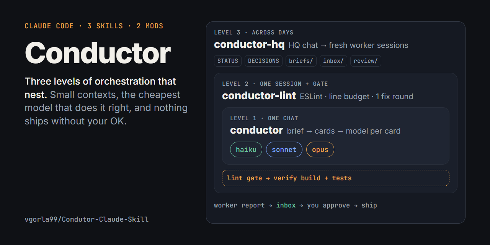
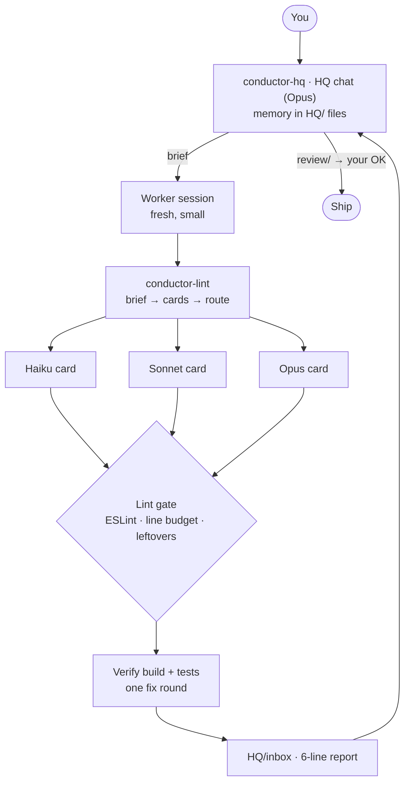
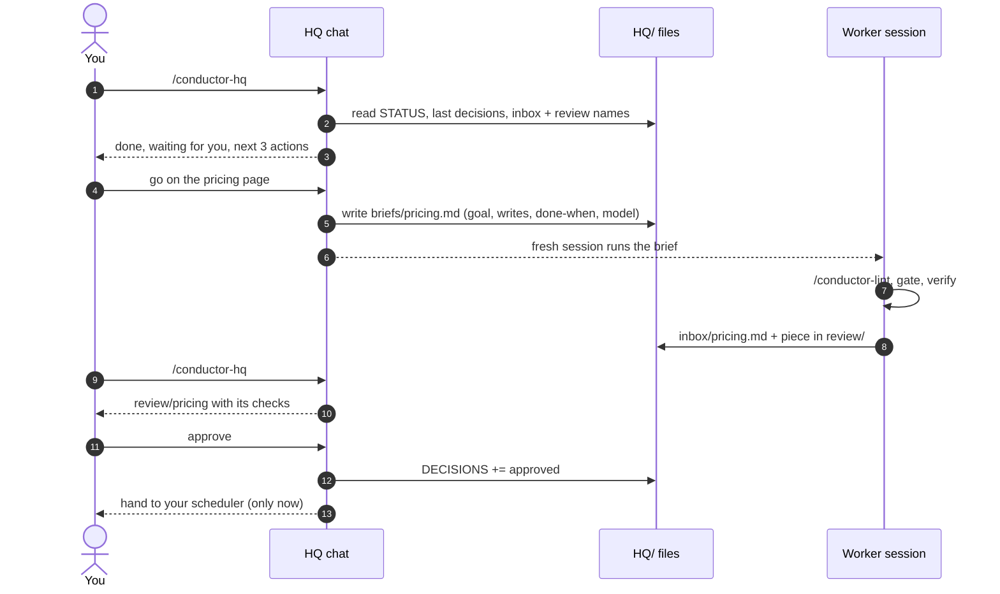
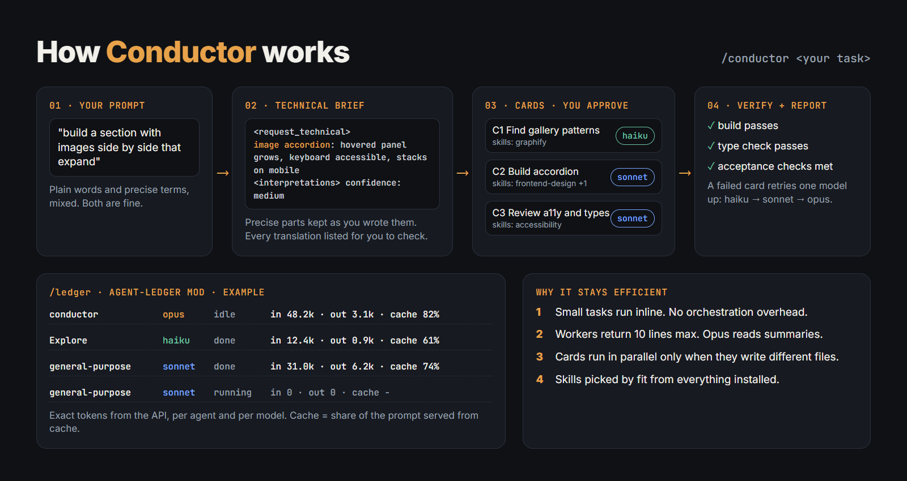

# Conductor

**Three levels of orchestration for Claude Code that nest: subagents in one chat, a quality gate on top, and whole sessions across days.**

[](LICENSE)
[](#the-three-levels)
[](#the-mods)
[](https://docs.claude.com/en/docs/claude-code)



## Why

A chat re-reads its whole history on every message. The longer it runs, the more each message costs, and the more old detail crowds the model's attention. One long chat that plans, codes, reviews and remembers a project for a week is the most expensive way to work.

Conductor keeps every context small:

- **Subagents** do the reading and the bulk work, and answer the main chat in 10 lines.
- **Each piece of work runs on the cheapest model that does it right:** Haiku when the task is tightly specified, Sonnet when it needs judgment, Opus when a wrong answer is expensive.
- **Fresh sessions** do each day's work from a 30-line brief, while the project's memory lives in a few short files instead of a chat.
- **Nothing ships without your OK.**

The goal is token **and** work efficiency: fewer tokens for the same result, and fewer leftovers for you to clean up. Not "spend less at any cost".

## The three levels

| Level | Skill | Orchestrates | Adds | Branch |
| --- | --- | --- | --- | --- |
| 1 | `conductor` | subagents inside one chat | brief → task cards → skills, agent and model per card → verify | `main` |
| 2 | `conductor-lint` | same as level 1 | ESLint on each worker's lines, a line budget per card, one fix round | `feature/conductor-lint` |
| 3 | `conductor-hq` | whole sessions across days | HQ chat with memory in `HQ/` files, fresh worker sessions from briefs, inbox and review | `feature/conductor-hq` |

They nest rather than compete: the HQ launches a worker session, the worker runs `conductor-lint`, and `conductor-lint` is `conductor` with a gate.



### A working day with conductor-hq



### Inside one session (levels 1 and 2)



More diagrams: [docs/flow.md](docs/flow.md). The deep dive per level: [docs/how-it-works.md](docs/how-it-works.md).

## Which level do I need?

| You want to | Use |
| --- | --- |
| Build one feature with several independent parts, today | `conductor` |
| Same, and you want lint-clean code with no TODOs or stubs left behind | `conductor-lint` |
| Run a project (a product, a brand, a site) over weeks without one chat growing forever | `conductor-hq` |
| Organise an old project spread over several folders | `conductor-hq adopt` |
| Fix one bug in one file | none: just ask. All three skip orchestration when it would not pay. |

## Install

Requirements: **Claude Code v2.1.287 or later** for the mods (`claude --version`). Access to **Opus** for the conducting session. The skills alone work on any recent version.

### As plugins (easiest)

Inside Claude Code:

```text
/plugin marketplace add vgorla99/Condutor-Claude-Skill
/plugin install conductor@conductor
/plugin install conductor-lint@conductor
/plugin install conductor-hq@conductor
/plugin install agent-ledger@conductor
/plugin install agent-lint@conductor
/reload-plugins
```

Install only the levels you want. Installed as plugins, skills are namespaced, for example `/conductor-hq:conductor-hq`.

### Manual (nothing runs unless you start it)

```bash
git clone https://github.com/vgorla99/Condutor-Claude-Skill.git ~/conductor
cd ~/conductor
```

| Level | Copy |
| --- | --- |
| 1 | `cp -r plugins/conductor/skills/conductor ~/.claude/skills/` |
| 2 | `cp -r plugins/conductor-lint/skills/conductor-lint ~/.claude/skills/` (plus level 1) |
| 3 | `cp -r plugins/conductor-hq/skills/conductor-hq ~/.claude/skills/` (plus levels 1 and 2 for code workers) |

Windows PowerShell, for example level 3:

```powershell
Copy-Item -Recurse "$HOME\conductor\plugins\conductor-hq\skills\conductor-hq" "$HOME\.claude\skills\"
```

Load the mods for one session only:

```bash
claude --model opus --plugin-dir ~/conductor/plugins/agent-ledger --plugin-dir ~/conductor/plugins/agent-lint
```

`--plugin-dir` is a terminal flag. In the desktop app, install the mods through `/plugin`.

Optional for level 3: choose where projects live with `~/.claude/conductor-hq.json`:

```json
{ "PROJECTS_ROOT": "D:/Work/Projects" }
```

Default: `~/Documents/Claude/Projects`.

## Quick start

**Level 1 or 2**, in a session on Opus:

```text
/conductor build a pricing section with three plans and a monthly/yearly toggle
/conductor-lint build a pricing section with three plans and a monthly/yearly toggle
```

You get a brief and task cards first, and nothing runs until you approve.

**Level 3**, one project per chat:

```text
/conductor-hq new MyBrand
```

Then every working day, in a new chat: `/conductor-hq`. At the end of the day: `/conductor-hq close`, and close the chat. The files remember.

Copy-paste prompts: [start-prompts.md](plugins/conductor-hq/skills/conductor-hq/references/start-prompts.md).

## Commands

| Command | Level | What it does |
| --- | --- | --- |
| `/conductor <task>` | 1 | Brief, cards, then waits for your approval |
| `/conductor-lint <task>` | 2 | Same, plus the lint gate and one fix round |
| `/conductor-hq` | 3 | Resume: status, waiting for you, next 3 actions, offers workers |
| `/conductor-hq new <Name>` | 3 | Create an organised project |
| `/conductor-hq adopt <Name> <paths>` | 3 | Organise an old scattered project, safely ([guide](docs/adopt-guide.md)) |
| `/conductor-hq worker <brief>` | 3 | Run one brief in a fresh session and report to the inbox |
| `/conductor-hq close` | 3 | Update the HQ files so the chat can be closed |
| `/ledger` | mod | Every agent, its model, tokens and cache share |
| `/ledger-reset <label>` | mod | Start a named run |
| `/ledger-export` | mod | Save the run as JSON |
| `/leftovers` | mod | What workers left behind (TODOs, stubs, lint, scope) |
| `/agent-lint eslint on` | mod | Let agent-lint run the project's ESLint (off by default) |

## Model routing

Every card (level 1 and 2) and every worker brief (level 3) gets its model from the same rubric. The model is always set explicitly, because many specialist agents pin Sonnet in their own definition.

| Model | Used for |
| --- | --- |
| Haiku 5.5 | **the default** when the work passes the **spec test**: exact files to write, an existing pattern to follow, checks a command can verify. Components following a pattern, styling, single-file features, tests from a spec, config, docs, search |
| Sonnet 5.5 | judgment: multi-file work without a pattern, unknown-cause bugs, reviews, creative pieces with a clear brand guide, research |
| Opus 5.5 | the conductor and the HQ themselves; architecture, auth, payments, migrations, data-loss risk |

Risk beats size: a one-line change to auth still goes to Opus or gets a security review. Work too big for the spec test is split, not sent up a model whole. A failed card retries once on the next model up.

## Level 3 in one picture

```text
<Projects>/<Name>/
├── CLAUDE.md          "read HQ/STATUS.md first"
├── HQ/
│   ├── STATUS.md      now / next / waiting on you (~40 lines, rewritten)
│   ├── DECISIONS.md   dated one-liners
│   ├── BRAND.md       audience, voice, colours, handles
│   ├── BACKLOG.md     tasks and ideas by role
│   ├── ANALYTICS.md   latest numbers
│   ├── briefs/        one per worker task
│   ├── inbox/         one 6-line report per finished brief
│   └── review/        waiting for your OK
├── content/  assets/  site/  analytics/  archive/
```

A new HQ chat reads about a hundred lines, however old the project is. Workers are fresh sessions, not forks (a fork copies the whole conversation). They never post, send, pay or delete; finished pieces wait in `review/` for you.

**Adopting an old project** is read-only until you approve: a script fingerprints every file without opening it, Claude writes a migration plan, you approve, files are copied and verified by hash, and the old folders are renamed, never deleted. Walkthrough: [docs/adopt-guide.md](docs/adopt-guide.md).

## The mods

Mods are Claude Code plugins with a hooks module. They measure and report; they never block your work, and if one fails, your prompts pass through untouched.

**agent-ledger** · `/ledger` opens a pane:

```text
conductor            opus    idle     in 48.2k  out 3.1k  cache 82%
Explore              haiku   done     in 12.4k  out 0.9k  cache 61%
general-purpose      sonnet  running  in 0       out 0     cache -
By model
opus     in 48.2k  out 3.1k  cache 82%
haiku    in 12.4k  out 0.9k  cache 61%
```

Tokens come from the API's own usage numbers, not estimates. A band above the prompt shows the last turn's tokens by model. Level 3 workers bracket their run with `/ledger-reset` and `/ledger-export`, so the HQ sees what each worker cost. (Version 0.3.0 renamed the commands from `/agents` to `/ledger`, since Claude Code now has a built-in `/agents`.)

**agent-lint** · ESLint for agent work. When a worker finishes, it checks only the lines that worker added:

| Rule | Severity | Catches |
| --- | --- | --- |
| `todo-left` | error | TODO / FIXME / HACK / XXX |
| `stub-left` | error | not implemented, `throw new Error("TODO")`, lorem ipsum, TBD |
| `skipped-test` | error | `.only`, `.skip`, `xit`, `@pytest.mark.skip` |
| `out-of-scope` | error | files changed outside the card's `writes` |
| `open-issue` | error | the worker's own "open issues" line |
| `eslint/<rule>` | as configured | the project's ESLint on added lines. Off until `/agent-lint eslint on`, because ESLint runs the project's config as code |
| `diff-budget` | warn | lines over the card's budget |
| `console-left`, `any-type` | warn | debug output, `any` in TypeScript |

Test either mod:

```bash
cd plugins/agent-ledger   # or plugins/agent-lint
claude plugin validate .
claude plugin test .
```

## What's in this repo

| Path | What it is |
| --- | --- |
| `plugins/conductor/` | Level 1 skill |
| `plugins/conductor-lint/` | Level 2 skill, with an ESLint setup reference |
| `plugins/conductor-hq/` | Level 3 skill, inventory scripts (PowerShell and bash) and start prompts |
| `plugins/agent-ledger/` | Token ledger mod, with tests |
| `plugins/agent-lint/` | Leftovers / lint mod, with tests |
| `docs/` | [how-it-works](docs/how-it-works.md), [flow](docs/flow.md), [adopt-guide](docs/adopt-guide.md), [comparison](docs/comparison.md) |
| `assets/` | Cards for README and social posts; HTML sources in `assets/src/` |
| `.claude-plugin/marketplace.json` | Lets you install everything through `/plugin` |

## Comparison results

The same three tasks (a UI component, a multi-file feature, a bug fix), run through each level, measured in tokens, time, quality and fix rounds. Method and scorecard: [docs/comparison.md](docs/comparison.md).

| Arm | Total tokens | Opus share | Wall time | Final lint errors | Fix rounds | Rating |
| --- | --- | --- | --- | --- | --- | --- |
| A · conductor | not measured yet | | | | | |
| B · conductor-lint | not measured yet | | | | | |
| C · conductor-hq | not measured yet | | | | | |

## FAQ

**Do I need all three?** No. Each level works alone. Level 3 uses level 2 for code workers when it is installed, and falls back to level 1 or to plain work.

**Does it run by itself?** No. All three skills run only when you type the command.

**Why Opus for the conductor if the goal is saving tokens?** Planning and verification are where a wrong call is expensive. The conductor reads summaries, not files, so its context stays small; the bulk of the tokens are spent by cheaper workers.

**Is routing enforced?** Not by Claude Code itself. The skills instruct the model, and the ledger shows you what actually ran where. An opt-in routing guard is on the roadmap.

**Does level 3 post or send anything?** Only after your explicit OK on a piece in `review/`, and only through your own posting or scheduling skill.

**Windows, macOS, Linux?** All three. The adopt inventory ships as `inventory.ps1` (Windows PowerShell 5.1 and PowerShell 7) and `inventory.sh` (bash, needs `python3`). Tested on Windows 11.

**What about desktop-app chats when a project moves?** Chats are tied to a folder path and do not follow a moved project. Start new ones in the new folder.

## Known limits

- Mods are a new Claude Code API; events can change between releases. Tested with Claude Code 2.1.289 on Windows 11.
- The conductor row in the ledger counts the main session's own requests. If a Claude Code version folds subagent usage into the main turn, that row reads high; please open an issue.
- Level 3 launches workers through the desktop app's new-session feature or a `claude` command you run; there is no headless scheduler built in.

## Roadmap

- **Routing guard:** an opt-in `agent.spawn` hook that enforces the rubric's model and an Opus budget.
- **Prompt cost preview:** estimate input tokens before a turn runs.
- **Comparison results:** fill the table above.

## Share it

A post card (1080×1350) is in [assets/overview-card.png](assets/overview-card.png); the cards are plain HTML in `assets/src/`. Render one with any Chromium browser:

```bash
chrome --headless=new --hide-scrollbars --window-size=1280,640 --screenshot=assets/levels.png assets/src/levels.html
```

## Credits

- ESLint setup in `conductor-lint` is based on [Matheus Gomes' ESLint setup guide](https://github.com/soumatheusgomes/vibe-coding-toolkit/blob/main/docs/prompts/07-eslint-complete-setup.md) (MIT).
- Optional cross-provider review uses the [Codex plugin](https://github.com/openai/codex-plugin-cc) when you have it set up.
- Built with Claude Code.

## License

MIT © Vitor Gorla
