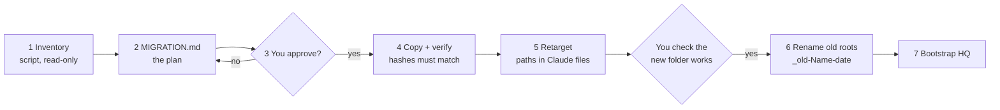

# Adopting an old project, safely

`/conductor-hq adopt` turns a project spread over several folders (a Desktop folder, a Documents folder, an old export) into one organised folder with an `HQ/`. It is built so that **nothing is lost and nothing is deleted**, and so Claude spends as few tokens as possible doing it.



## Before you start

- Run adopt in its **own fresh chat**, one project per chat.
- Close editors and apps that have files open in the old folders.
- Have enough free disk space for one full copy (files are copied, not moved).

```text
/conductor-hq adopt MyBrand "C:\Users\<you>\Desktop\MyBrand" "C:\Users\<you>\Documents\MyBrand stuff"
Inventory first, then MIGRATION.md, then wait for my OK.
```

macOS / Linux: `"~/Desktop/MyBrand" "~/Documents/MyBrand stuff"`.

## 1. Inventory (read-only)

A script lists every file under the old folders: path, type, size, date, a SHA-256 fingerprint, and whether the name looks private. It never prints file contents, and Claude never opens them. It skips `node_modules`, `.git`, virtual environments and build output.

| OS | Command (run by Claude) |
| --- | --- |
| Windows | `powershell -ExecutionPolicy Bypass -File scripts/inventory.ps1 -Out "<new>/HQ/migration" "<old1>" "<old2>"` |
| macOS / Linux | `bash scripts/inventory.sh "<new>/HQ/migration" "<old1>" "<old2>"` (needs `python3`) |

Output, in `HQ/migration/`:

- `inventory.csv`: one row per file.
- `SUMMARY.md`: files and MB per top folder, file types, duplicates, same-name conflicts, possibly private files.

Claude reads only `SUMMARY.md` and filtered slices of the CSV. That is why adopt stays cheap even for tens of thousands of files.

## 2. MIGRATION.md (the plan)

Claude writes `HQ/migration/MIGRATION.md` with:

| Section | What it holds |
| --- | --- |
| Target tree | the new folder layout |
| Move table | old folder → new folder (whole folders wherever possible) |
| Duplicates | same fingerprint: keep one, list the rest |
| Conflicts | same name, different content: keep both, one gets a suffix |
| Archive | old material that is kept but never loaded |
| Private | `.env`, keys, credentials, customer exports: **names only**, never opened, moved as they are |
| Pointers | every file that mentions the old paths: CLAUDE.md files, `.claude/skills`, memory notes, links or junctions, editor project files, scheduled tasks |

## 3. You approve

Nothing moves until you say so. Edit the plan, ask for changes, or stop here.

## 4. Copy, then verify

Folder by folder:

- Windows: `robocopy "<src>" "<dst>" /E /COPY:DAT /R:1 /W:1 /LOG:<file>`
- macOS / Linux: `rsync -a "<src>/" "<dst>/"`

Then every copied file's fingerprint is compared with `inventory.csv`. One mismatch, and Claude reports it and stops.

## 5. Retarget

The files in the plan's Pointers list are updated to the new paths. Chats tied to a folder path (for example desktop-app sessions) do not follow the move; start new ones in the new folder.

## 6. Rename the old folders, never delete

Only after you have opened the new folder and checked it works, each old root is renamed to `_old-<Name>-<yyyy-mm-dd>`. Deleting them is your call, by hand, later.

## 7. Bootstrap HQ

`HQ/BRAND.md`, `STATUS.md` and `BACKLOG.md` are filled from what was found, and each choice made during the migration becomes one line in `DECISIONS.md`. From the next day on, open a new chat in the project and type `/conductor-hq`.

## If something goes wrong

| Problem | What to do |
| --- | --- |
| Hash mismatch after copy | Claude stops. Close whatever app holds the file, re-run the copy for that folder. |
| A path you forgot to list | Add it to MIGRATION.md and run step 5 again. |
| You want to undo | The old folders are untouched until step 6, and only renamed after it. Rename them back and delete the new folder. |
