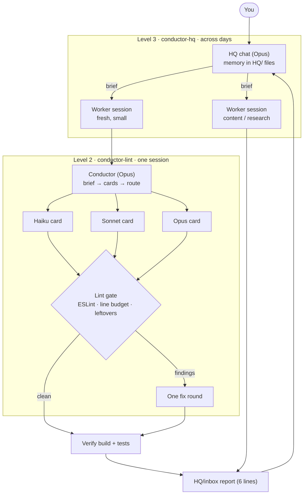
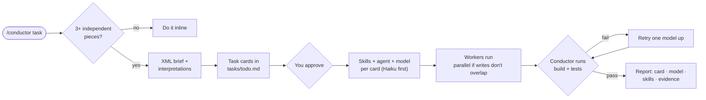
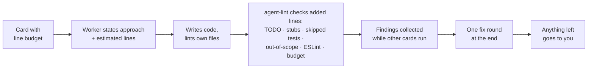
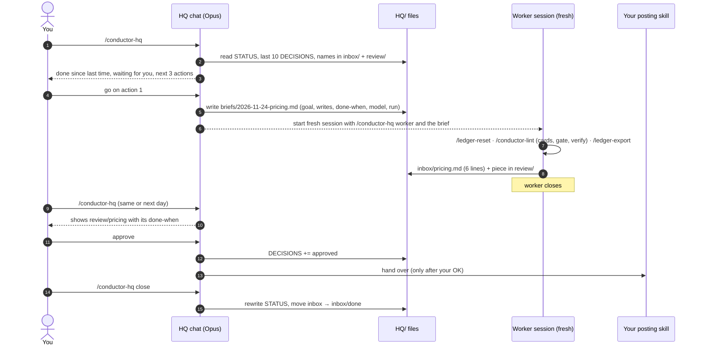
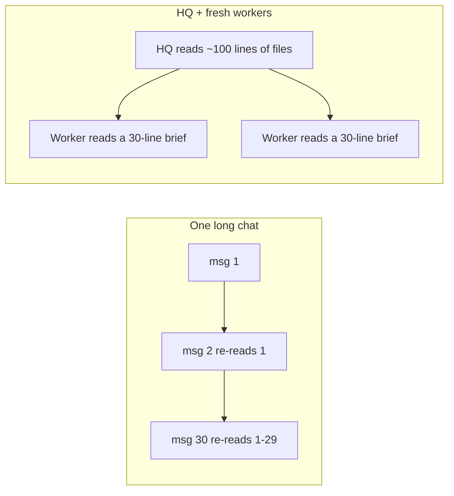

# Flows

Diagrams of how work moves through each level. They render on GitHub.

## How the levels nest

Level 1 (`conductor`) is Level 2 without the lint gate.

## Level 1 · conductor (one chat, subagents)

## Level 2 · conductor-lint (adds the gate)

## Level 3 · conductor-hq (a working day)

## Why sessions instead of one long chat

Every message in a chat sends the whole history again. Caching softens it, but context still grows, and long contexts are slower and blur the model's attention. Files are a fixed, small cost per session.
